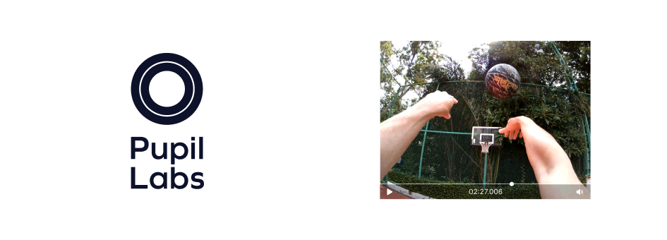

# Pupil Labs Video

[](https://github.com/pupil-labs/pl-video/actions/workflows/main.yml)
[](https://pupil-labs.github.io/pl-video/)
[](https://github.com/astral-sh/uv)
[](https://github.com/astral-sh/ruff)
[](https://github.com/pre-commit/pre-commit)
[](https://pypi.org/project/pupil-labs-video/)
[](https://pypi.org/project/pupil-labs-video/)

[](https://pupil-labs.com/)

A high-level wrapper of [PyAV](https://github.com/PyAV-Org/PyAV) providing an easy to use interface to video data.

The goal of this library is to provide a simple interface while maintaining good computational performance. At current, only MP4 and MJPEG videos are officially compatible.

Features include:

- Performant reading of video files (optionally including audio) utilizing multi-threading.
- Ability to arbitrarily index frames by their index or timestamp.
- Ability to slice the video by frame index or time. Large slices will be loaded lazily to avoidexcessive RAM consumption.
- A frame buffer is maintained to cache frames close to the current decoding position, which avoids repetitive seeking when going back and forth between frames in the same neighborhood or iterating backwards.
- Avoids demuxing and seeking operations as much as possible.
- Reading multi-part video files (e.g. how they are generated by Neon or Pupil Invisible).

## Installation

```
pip install pupil-labs-video
```

or

```bash
pip install -e git+https://github.com/pupil-labs/pl-video.git
```

## Quick Start

You can open a video file and read frames like this:

```python
import pupil_labs.video as plv

with plv.Reader(video_path) as video:
    # Iterate through video frames
    for frame in video:
        # Convert video frame to BGR array
        img = frame.bgr

    # Index individual frames or slices
    first_frame = video[0]
    last_frame = video[-1]
    frames = video[10:20]

    # Index frames by time
    ts = video[10].time
    frame = video.by_container_timestamps[ts]
    frames = video.by_container_timestamps[ts : ts + 10]
```

You can write video files like this:

```python
import pupil_labs.video as plv

with (plv.Writer(out_path) as writer):
    for img in images:
        writer.write_image(img)
```

## The new reader

`pupil_labs.video_reader` is a reader for MP4 files that seeks from the frame table the file already holds, so any frame of a long video is a fraction of a second away. It is indexed like a numpy array, as `docs/adr/0001-the-reader-is-indexed-like-a-numpy-array.md` records:

```python
import numpy as np
from pupil_labs.video_reader import Reader

with Reader(video_path) as video:
    frame = video[-1]  # one frame: index, time, pts, bgr, rgb, gray
    every_tenth = video[::10]  # a Selection: nothing decoded yet
    picked = video[[5, 3, 5]]  # any order, repeats allowed
    later = video[video.timestamps > 10.0]  # a Boolean mask
    for frame in every_tenth:  # several keyframe groups decode at once
        img = frame.bgr
    at_12_5_s = video[np.searchsorted(video.timestamps, 12.5)]  # a frame by time
```

It assumes closed keyframe groups, as Neon and Pupil Invisible write them: no frame refers to one before its group's keyframe. On an open-GOP file it returns wrong images for the frames that do.

It needs Python 3.13. Two commands hold it to pl-video's `Reader` on the videos under `/mnt/data/recordings` and `tests/data` (`git lfs pull` first):

- `make compare` compares `index`, `time`, `pts`, `.bgr`, `.rgb` and `.gray` of every frame and lists each mismatch.
- `make benchmark` times both readers per scenario and video, five fresh processes each, and checks the new one is no slower and uses no more memory.
